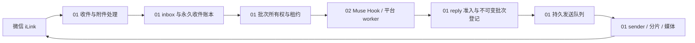

# 公共能力、文件 owner 与 Muse 耦合

任务：`WBR-01-20261023-001`。分析源码同本目录 README；**下表细化首轮 owner，未来目录/API 拆分仍为候选**。

## 1. 当前文件归属

| 文件 / 范围 | 实施 owner | 协同复核 | 当前职责与证据入口 |
| --- | --- | --- | --- |
| `wechat_bridge/ilink.py` | 01 公共底座 | 02 验证现网兼容 | HTTP/认证头、QR、文本分片与稳定 client ID；`base_info:40`、`auth_headers:48`、`send_message:138` |
| `wechat_bridge/crypto.py` | 01 | 各线按附件需求反馈 | AES key 解析、媒体加解密；属于微信传输能力，不属于模型后端 |
| `wechat_bridge/media.py` | 01 | 02 现网媒体验收；03/04 报宿主限制 | 下载/解密、上传和媒体发送；`download_media:39`、`upload_media:186`、`send_media_message:253` |
| `wechat_bridge/store.py` | 01 | 02 核对旧路径/状态兼容 | 数据布局、原子写、收件锁/账本、隔离证据；`Store:32`、`message_receipt_lock:79`、`_atomic_write:120` |
| `wechat_bridge/serve.py` | 01 | 02 提供绑定版本的运行证据 | owner 过滤、收件/附件持久化、游标推进、发送队列/FIFO/重试/分片、单实例/线程监督；`handle_incoming:197`、`flush_outbox:831`、`run:1070` |
| `wechat_bridge/worker_state.py` | 01，暂不拆 owner | 02 必须复核平台唤醒/路径/寿命要求 | 锁、批次所有权、租约、回复准入、恢复/告警；还包含宿主进程识别/重启与 CLI，见第 3 节 |
| `wechat_bridge/cli.py` | 01 | 02 登录/运维兼容；03/04 报入口需求 | 登录、直接 send、serve、status；当前没有 backend/session/cancel/approval 命令（`main:378`） |
| `wechat_bridge/__init__.py`、`__main__.py`、`pyproject.toml` | 01 | 02/03/04 提接入依赖 | 一个公共包和 CLI；各线不复制独立发行入口，不在本轮改包名/版本 |
| `hooks/WORKER-STATE.md` | 01 | 02 复核真实 prompt 的协议配套 | 公共 begin/refresh/reply/release 及恢复语义；文件位于 hooks 不改变 owner |
| `hooks/wechat-inbox-watch.sh`、`.json` | 02 Muse | 01 复核公共状态协议 | 外部 `HATCH_HOOK_RUNTIME`、wake/silent、平台 prompt、轮询/超时/投递目标 |
| `docs/MUSE-TESTING.md` | 02 | 01 复核公共用例与证据要求 | 实机流程、B1–B8、真实包/Hook/prompt 配套、手机确认；不由 01 重复索取报告 |
| `docs/CONNECTOR.md` | 01 | 02 复核运维/平台章节 | 现有公共运行说明混有旧平台阈值；记录差异，修改时跨线联评 |
| 现有 `tests/*.py`、`tests/run_offline.py` | 01 | 02 复核涉及 Hook 的断言 | 公共/兼容回归及隔离入口；旧套件存在不代表本轮运行通过 |
| `tests/test_hook_*.sh`、`tests/fixtures/hook_runtime.sh` | 01 暂持有测试文件 | 02 复核宿主契约 | 平台边界的公共兼容回归；fixture 是假 runtime，不可部署为真实 Muse runtime |
| 本目录 `docs/lines/01-core/` | 01 | 独立架构审阅；02/03/04 补需求 | 本任务候选与交接；不替 00 更新治理文档 |
| 03 Codex / 04 CC 未来适配代码 | 各自责任线 | 01 复核公共边界 | 实际路径/API 尚未冻结；本轮不先建实现目录或承诺 SDK 能力 |
| 项目治理/总任务/集成发布 | 00 | 各线报告 | `AGENTS.md`、首轮任务单、总台账由 00 归口；本线只写自己的 registration/report |

单个文件同阶段只有一个实施 owner。跨线需求先记变更请求；共同复核不等于双方同时编辑公共文件。

## 2. 当前可复用的数据流

现有链路只有 Muse 平台接入路径；上图不是已经实现的多后端 router。后续适配应接在公共所有权/执行边界，不另起微信收件服务。

当前收件仅面向已绑定机主，过滤非机主、群消息与非入站消息（`serve.py:197`）；不是读取全部联系人/群聊/历史的通用微信客户端。候选契约不能扩大现有可见范围。

## 3. 耦合清单与拆分约束

| 耦合点 | 已读事实 | 候选边界 / 本轮处理 |
| --- | --- | --- |
| 传输层品牌字符串 | `ilink.py:22` 的 `BOT_AGENT="Muse"` 进入协议元信息/请求头；`serve.py:297/:1166` 的探活/轮询还另有硬编码 Muse | 01 管传输元信息；02 核对服务端与现网兼容后再决定是否配置化，不能只改一个常量或仅为改名替换字符串 |
| 数据目录与重新登录告警 | `cli.py:25` 默认 `~/workspace/wechat-bridge`；`store.py:17` 的重新登录通知路径绑定 `~/hooks/state` | 01 设计显式宿主配置；02 确认旧真实路径。当前常量不等于已响应全部环境变量，不据此单独定实机故障根因 |
| 公共 worker 与宿主监督同文件 | `worker_state.py:47` 为消息状态机；`:736` 起识别 Linux `/proc` / macOS `ps`，`:779` 起 supervise/restart；`:809` 设置 TZ | 公共状态机归 01；未来宿主 supervisor 为可替换边界。先不移动函数或切 owner，公共阈值、宿主健康阈值和平台时限分开 |
| 外部平台 runtime | Hook `:12/:24` source `HATCH_HOOK_RUNTIME`；`:44` 起调用 wake 并记录接受尝试 | 02 管真实 runtime、唤醒与投递配置；01 只定义所需结果语义。不把 wake exit 0 写成任务启动或结果送达 |
| 平台模型 prompt | Hook JSON 指导模型直接调用 begin/refresh/reply，含路径、worker 期限、异常处理 | 02 管平台指令；01 管机器协议。未来契约变更需包/脚本/真实 prompt 配套，不只改仓库 JSON |
| 租约与长任务 | `worker_state.py:106` 的 worker 截止为软 90 / begin 起硬 570 秒；平台可更早结束 worker | 保持现语义。等待审批/长工具调用的解决方案是待确认的执行生命周期，不是放宽期限 |
| 续租中的“进展” | `refresh:387` 验证活 lease 后更新 last；当前没有传入/核验工具进展证据的字段 | “真实进展后续租”目前也是 worker/prompt 的调用约束；不能把调用 refresh 本身当已证明工具在工作 |
| 会话概念混用 | `Store.session_path:55` 存微信凭据；`worker_state._batch:149` 返回微信 context；没有公共 Agent session map | 01 增设独立的路由/映射候选，02/03/04 提供后端真实 session 能力，不复用凭据文件 |
| 取消/审批未定义 | 现有公共命令只有 claim/begin/refresh/release/reply 等；release 不调用平台取消 | 新能力必须显式声明、返回 unknown/unsupported，不将 release、进程退出或文本“已取消”当后端确认 |
| 本地附件路径 | 入站记录为 `media_paths`，失败为聚合计数；worker reply 一次提交一个 `media_path` | 候选用附件引用与可达性声明，迁移适配保留原顺序与失败信息；不臆造旧记录缺失的逐项 MIME/hash/失败归属，不承诺所有后端支持多文件 |
| sender 自动合并 | `serve.py:831` 起按接收人和时间窗口合并可合并文本，当前没有 backend/conversation/output_kind 分组 | 启用多后端前需增加明确合并域，不能将审批提示、不同后端结果或不同会话回复混在一条消息里；旧合并 envelope 仍不可重写 |
| 日志脱敏并非全链路保证 | receiver 外层只记异常类型，但 `media.py:79` 仍会拼接下载异常字符串 | 列为独立的合成错误/日志回归候选，不据此推断已泄漏真实秘密，不在本任务顺手改代码 |

## 4. 应维持的公共不变量

4.1 同一 bot 一个收件服务；同一发送者当前只有一个消息 owner，不能按 backend 分锁后并发 claim 同一 sender。当前 sender 范围在单个隔离 Store 内，跨账号要另作 scope。

4.2 receipt 锁在前、claim 锁在后；旧事件只能消费一次，过期 worker 不能 refresh/reply。需要新字段或新存储格式时由 01 提迁移方案，而非适配线手改旧状态。

4.3 后到消息进入当前批次，reply 必须覆盖最新 owned，发现缺项返回 needs_refresh 且不入队。不能仅扩 ID 而沿用未处理新消息的旧正文；不承诺无限等待未来输入。

4.4 收件完成/入队、后端成功、API 接受、手机收到是不同事实。失败、未知投递和 prepared/publishing 不制造新身份重放。

4.5 03/04 不直接写 outbox、receipt、claim/seen/started，不直接持有微信 bot token。Muse 现有受信任 worker/helper 路径按旧协议保留；未来收窄令牌暴露需与 02 一起迁移，不能宣称本轮已经隔离。

4.6 当前 serve 锁位于各 Store（`serve.py:969`），不会自动阻止另一 base 使用同一个 bot；“单 bot 单 receiver”目前还需要部署约束。监督识别验证 PID/启动时间/命令位置，但不等于完整 executable/base 实例绑定，更不能直接推广为任意后端进程的生命周期管理。
